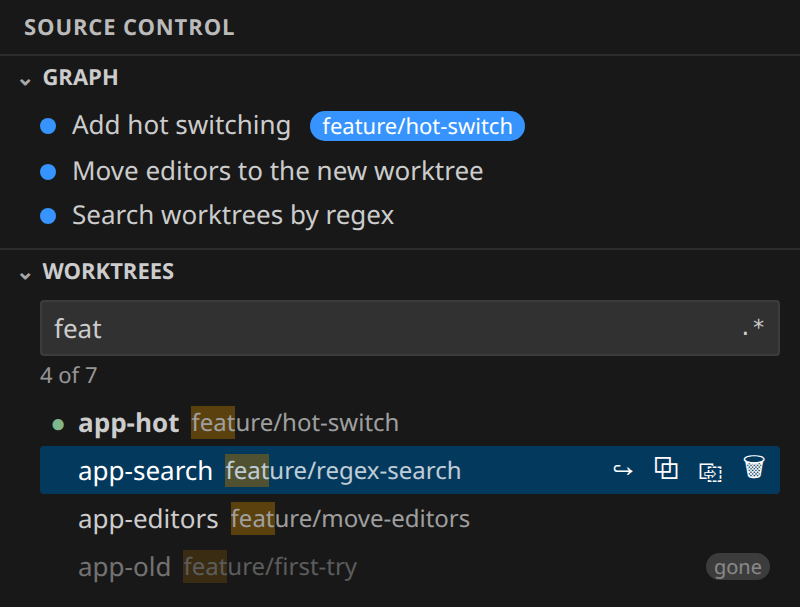

# Worktree Hopper

**Switch git worktrees from the Source Control view, in place, without reloading the window.**

A **Worktrees** panel sits under Changes and the Graph. Type a few letters of a folder, branch or path, press Enter,
and the window is on that worktree, with your open files, the Graph and Changes following along.

## Why

If you keep a worktree per task or pull request, getting to the right one means *File → Open Folder*, a full
reload, and losing your terminals and chat. With Worktree Hopper it is one click, and nothing restarts.

## Features

- **Every worktree, in Source Control.** Folder, branch (or detached commit), and tags for `main`, `open`, `gone`
  and `locked`. ● marks the active one.
- **Search by text or regex.** Name, branch or path, with matches highlighted. **Alt+R** or `.*` toggles regular
  expressions.
- **Hot switch.** No reload: extensions, terminals and chat panels keep running.
- **Your editors come along.** Open files reopen at the same path in the new worktree; unsaved ones stay put.
- **Source Control follows.** Changes and the Graph show the active worktree, scrolled to its current commit.
- **Delete with a confirmation.** 🗑 (or the Delete key) asks Yes/Cancel. Uncommitted changes or a lock ask a
  second time. The branch is kept.
- **New window when you want one.** Alt+click, or ⧉ on the row.

## Keyboard

| Key | Action |
|---|---|
| **Ctrl+Alt+W** (**Cmd+Alt+W**) | Jump to the search box |
| ↑ / ↓ | Move through the list |
| **Enter** | Switch in this window |
| **Alt+Enter** | Open in a new window |
| **Delete** | Delete the selected worktree (asks first) |
| **Alt+R** | Toggle regular expressions |
| **Esc** | Clear the search |

## How the hot switch works

VS Code restarts every extension when the *first* folder of a window changes, and not when a later one does. So
the folder you opened stays first, and the active worktree is swapped in as a second folder:

- The **first** switch turns the window into a multi-root workspace (extensions restart once; the window does not
  reload).
- **Every switch after that is instant.**
- Switching back to the first folder removes the second one.

Prefer one folder per window? Set `worktreeHopper.switchMode` to `reload`.

## Settings

| Setting | Default | What it does |
|---|---|---|
| `worktreeHopper.switchMode` | `hot` | `hot` swaps the worktree in place; `reload` reopens the window on it. |
| `worktreeHopper.openIn` | `sameWindow` | Where a plain click opens. Alt+click does the other. |
| `worktreeHopper.moveEditors` | `true` | On a hot switch, reopen open editors in the new worktree. |
| `worktreeHopper.followInGit` | `true` | On a hot switch, show only the active worktree in Source Control. |
| `worktreeHopper.revealInGraph` | `true` | After a hot switch, scroll the Graph to the worktree's current commit. |
| `worktreeHopper.hidePrunable` | `false` | Hide worktrees whose folder is gone. |

## Tips

- Drag the **Worktrees** header between Changes and the Graph; VS Code remembers where you put it.
- VS Code asks whether to trust each new worktree folder. Trust their parent folder once (**Workspaces: Manage
  Workspace Trust**) to skip that.
- Terminals already open stay where they were; new ones start in the active worktree.

## Requirements

- VS Code 1.85 or newer, or a compatible editor (Cursor, VSCodium, Windsurf).
- `git` on the machine where the workspace lives. Works locally and over Remote SSH, WSL and Dev Containers.

## Feedback

Found a bug or have an idea? [Open an issue](https://github.com/Niko412/worktree-hopper/issues).
