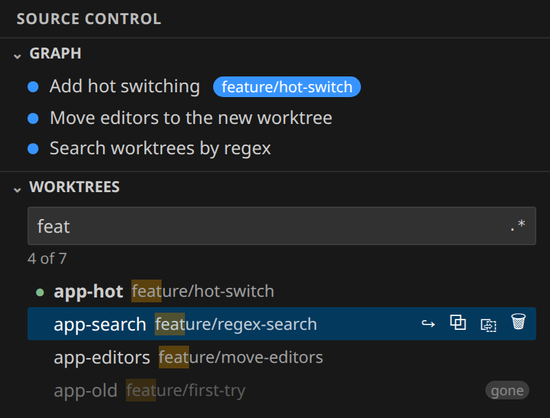

# Worktree Hopper

[](https://github.com/Niko412/worktree-hopper/actions/workflows/build.yml)
[](https://marketplace.visualstudio.com/items?itemName=NikolayChernuha.worktree-hopper)
[](https://marketplace.visualstudio.com/items?itemName=NikolayChernuha.worktree-hopper)
[](https://open-vsx.org/extension/NikolayChernuha/worktree-hopper)
[](https://github.com/Niko412/worktree-hopper/releases)
[](https://github.com/Niko412/worktree-hopper/actions/workflows/build.yml)
[](https://github.com/Niko412/worktree-hopper/actions/workflows/build.yml)
[](LICENSE)

A VS Code extension: a **Worktrees** panel in the Source Control view. Search git worktrees by text or regex and
switch to one in place, without reloading the window. Open files, Changes and the Graph follow the switch.



The Marketplace listing, with every feature, key and setting, is [MARKETPLACE.md](MARKETPLACE.md).

## Install

- **VS Code:** search *Worktree Hopper* in the Extensions view, or
  [install from the Marketplace](https://marketplace.visualstudio.com/items?itemName=NikolayChernuha.worktree-hopper).
- **Cursor, VSCodium, Windsurf:** install from [Open VSX](https://open-vsx.org/extension/NikolayChernuha/worktree-hopper).
- **By hand:** download the `.vsix` from [Releases](https://github.com/Niko412/worktree-hopper/releases), then
  `code --install-extension worktree-hopper-X.Y.Z.vsix`.

## What is tested

Every push and pull request runs, on GitHub's hosted runners:

| Suite | Where | What |
|---|---|---|
| Unit | Node 22 | Parsing `git worktree list`, search and regex, why git refused a delete, Windows paths, the manifest against the code and the README, the release guard |
| Integration | VS Code **1.85.0** (the minimum) and **stable**, on **Linux, Windows and macOS** | A real VS Code on a throwaway repository with worktrees: switch in place, editors moving, switching back, unsaved editors staying, delete refused, cancelled, asked twice for changes, and done |

The `.vsix` is built only after every test passes.

## Development

```sh
npm ci
npm test                    # unit tests
npm run test:integration    # downloads VS Code and runs the integration tests (needs a display; xvfb-run on Linux)
npx vsce package --readme-path MARKETPLACE.md
```

The code: [extension.js](extension.js) (the extension host side), [media/](media/) (the panel's webview),
[lib/worktrees.js](lib/worktrees.js) (pure helpers), [test/](test/).

## Releasing

A release is a `vX.Y.Z` tag on `main`; nothing else publishes.

1. In an ordinary commit, bump `version` in `package.json` and add a `## X.Y.Z` entry at the top of `CHANGELOG.md`.
2. Run `scripts/release.sh`. It tags `origin/main` at the version `package.json` writes, and pushes the tag.
3. CI's release guard ([scripts/release-guard.sh](scripts/release-guard.sh)) refuses the tag unless it is
   `vX.Y.Z`, `package.json` and the newest `CHANGELOG.md` entry carry that version, its commit is on `main`, it is
   higher than every earlier release, and it was not released before. After the tests pass, CI builds the `.vsix`,
   checks the version inside it too, and attaches it to a GitHub release.
4. Upload that `.vsix` to the [Marketplace](https://marketplace.visualstudio.com/manage) (New extension → Visual
   Studio Code, or Update) and to Open VSX (`npx ovsx publish worktree-hopper-X.Y.Z.vsix -p <token>`).

Tags `v*` cannot be moved or deleted, and `main` cannot be force-pushed or deleted (repository rulesets).

## Contributing

This repository takes issues, but only its owner can push or open pull requests. Bug reports and ideas are welcome
in [Issues](https://github.com/Niko412/worktree-hopper/issues).

## License

[MIT](LICENSE)
